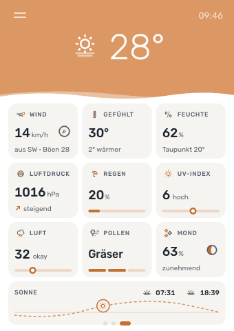
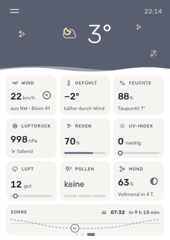
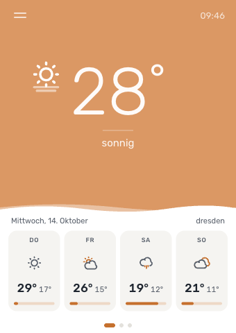
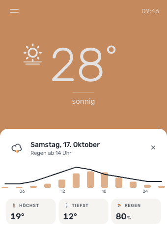
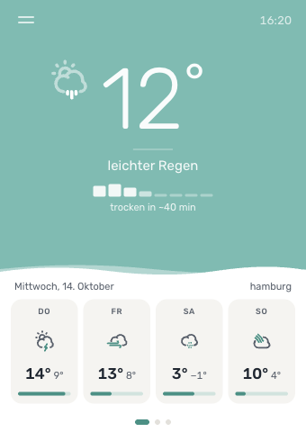
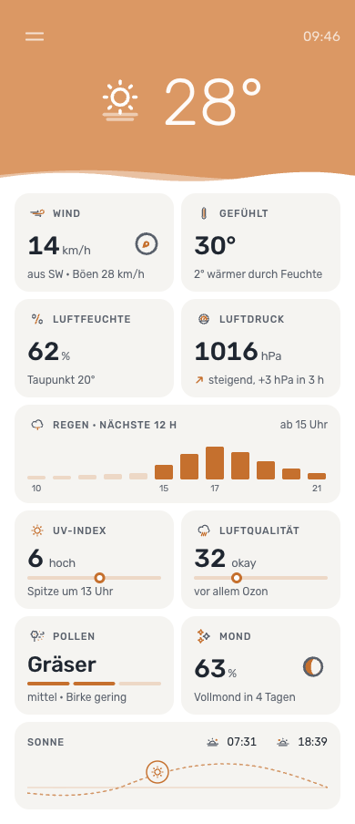
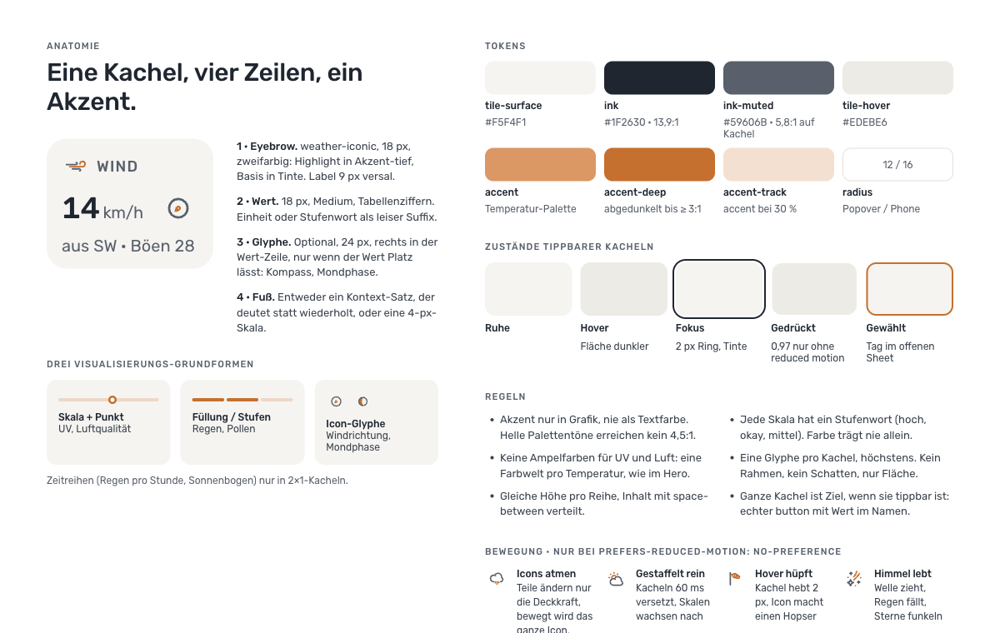
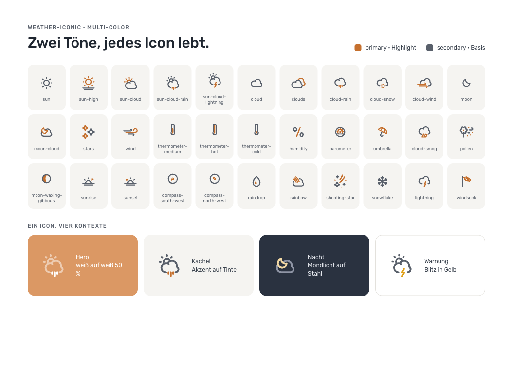
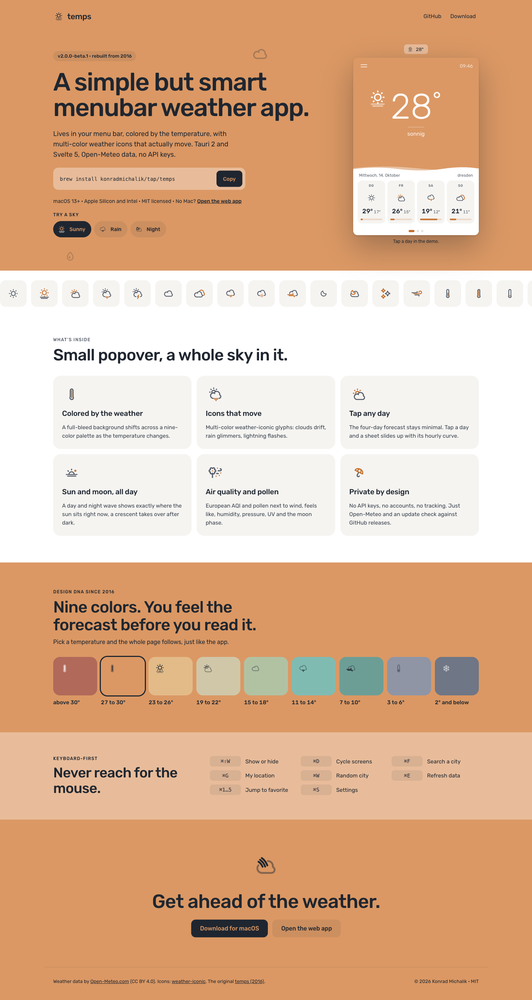

# Screen designs

The reference designs for the temps tiles, screens and landing page. They live on a design canvas: https://claude.ai/artifact/Q1uvm7SB8HB5Mvua3qUp4y. The canvas is private to its owner until it is shared from its Share menu.

Board titles are German. The app screens use German copy because the demo locale is German; the app ships both locales (see [rules.md](rules.md#copy)). The landing page uses English copy. Values in the mockups (temperatures, places, times) are examples.

The rules behind these screens are in [rules.md](rules.md). The previews are exports of the canvas in their resting state, taken with reduced motion; click one for the full size. When a board changes on the canvas, export it again and replace its file in `screens/`.

## App

| Board | Screen | What it settles | Preview |
| --- | --- | --- | --- |
| 1 | Details, warm, day | 3-column tile grid, tile anatomy, scale with dot, fill bar, pollen pips, compass and moon glyphs, 2×1 sun tile with the day wave |  |
| 2 | Details, cold, night | The same grid on a cold night accent, contrast-safe `accent-deep`, moon marker, twinkling stars in the sky |  |
| 3 | Overview | Forecast days as tile buttons with high, low and a rain bar; the board is interactive on the canvas |  |
| 4 | Day sheet | The sheet after tapping a day: hourly temperature line, rain bars, three mini stat tiles, close button |  |
| 5 | Overview, rain | Rain effect in the sky, nowcast strip under the condition, forecast with lightning, wind, snow and rainbow icons |  |
| 6 | Standalone, phone | 2-column grid, larger type, 2×1 tiles for the hourly rain and the sun wave, context lines in full |  |

## System

| Board | Screen | What it settles | Preview |
| --- | --- | --- | --- |
| 7 | Tile system | Anatomy, visualisation primitives, tokens, tap states, rules, motion |  |
| 8 | Icon library | All 33 weather-iconic icons in use, primary and secondary roles, one icon in four contexts |  |
| 9 | Landing page | Hero with live demo and sky switcher, icon band, feature tiles, nine-colour palette, shortcuts, download |  |

The canvas also holds `Icon.dc.html`, the icon component the boards share. It is a design tool, not a screen.
